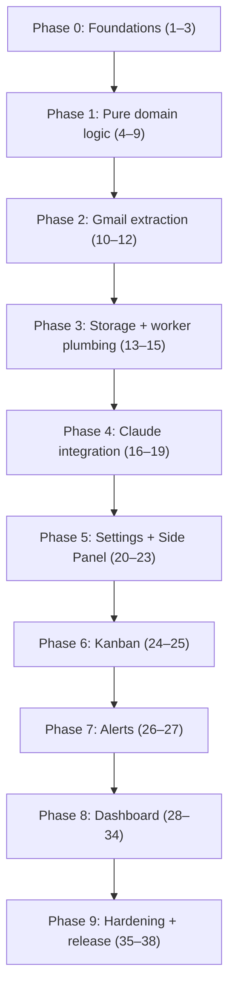

# Implementation Plan: Gmail Job Application Tracker

## Overview

Builds the Gmail Job Application Tracker defined in [requirements.md](./requirements.md) and [design.md](./design.md) as a Manifest V3 extension under `extension/`. Work proceeds domain-first (pure, tested logic), then Gmail extraction, storage and the service worker, Claude integration, the side panel and Kanban board, alerts, the dashboard, and finally hardening.

## Task Dependency Graph

The plan is strictly linear: task N starts only after task N−1 is done. The graph shows the phase structure and the few hard dependencies that explain the order.

Hard dependencies: 4 → 16 (validator used by the Claude client); 5–7 → 19 (merge used by persist); 8 → 19, 26; 9 → 29; 11 → 15 (parser used by the worker's extraction path); 13 → 14, 19, 20, 26 (storage layer); 19 → 24, 26, 27, 28; 18 → 22.

## Tasks

Tasks are strictly ordered. Each is one reviewable unit (aim: one commit / one small PR), and later tasks depend only on earlier ones. Domain logic comes first as pure, tested functions; contexts (content script, worker, UIs) are then wired on top of it. Requirement and design references are in brackets.

**Conventions**
- Code lives under `extension/` (see design §2). Run `npm test` and `npm run build` before marking a task done.
- "Done when" is the review checklist. Do not start a task until the previous one is done.

---

### Phase 0: Foundations

- [x] **1. Scaffold the project** [R13.4; design §2]
  - Create `extension/` with `package.json`, `tsconfig.json` (strict), Vite multi-entry config (service worker, content script, side panel, dashboard), Vitest, ESLint.
  - Add `@anthropic-ai/sdk` as the only runtime dependency.
  - Done when: `npm run build` emits an empty `dist/`; `npm test` runs with one placeholder test.

- [x] **2. Shared types and constants** [design §4.1, §7]
  - `shared/types.ts`: `Status`, `StatusEntry`, `Application`, `Alert`, `Settings`, `EmailPayload`, `AnalysisResult`, `AnalysisPreview`, `ErrorCode`, `Result<T>`.
  - `shared/messages.ts`: message type names and payload types from the design §4.2 table. `shared/constants.ts`: 12,000-char limit, 5 s timeout, column map, default model.
  - Done when: types compile; no runtime logic.

- [x] **3. Manifest and loadable shell** [R1.1–R1.6; design §3]
  - `public/manifest.json` per design; stub service worker that calls `setPanelBehavior({ openPanelOnActionClick: true })`; stub side-panel HTML that renders "Hello".
  - Done when: loaded unpacked in Chrome, the toolbar icon opens the side panel; permissions and host list match R1 exactly (check in `chrome://extensions`).

### Phase 1: Pure domain logic (no browser APIs)

- [x] **4. Analysis schema and validator** [R4.5; design §6.2]
  - `domain/schema.ts`: `ANALYSIS_SCHEMA` constant and a hand-written `validateAnalysis(unknown) → Result<AnalysisResult>`. Include `sanitizeAnalysis` that forces `status: null` for non-status email kinds (R4.6).
  - Tests: valid sample per `emailKind`; reject unknown enum values, missing fields, wrong types, extra keys.
  - Done when: all tests pass.

- [x] **5. Name normalization and matching** [R5.1; design §8.1–8.2]
  - `domain/normalize.ts`: `normalizeCompany`, `normalizeRole`, `companiesMatch`, `rolesMatch` (equal or Jaccard ≥ 0.7), domain hint.
  - Tests: suffix stripping, punctuation, "Sr."/"Senior", requisition ids, "Acme" vs "Acme Corp", different roles not matching.
  - Done when: table-driven tests pass.

- [x] **6. Application recompute** [R5.4–R5.8; design §8.5]
  - `domain/merge.ts` part 1: `recompute(app)` deriving `status`, `appliedAt`, `appliedAtEstimated`, `firstResponseAt`, `rejectedAt`, `lastUpdateAt` from sorted `history`.
  - Tests: out-of-order history, no `applied` entry (estimated), reject-then-interview, single entry.
  - Done when: tests pass.

- [x] **7. Merge engine** [R5.1–R5.3, R5.9–R5.10; design §8]
  - `domain/merge.ts` part 2: `applyAnalysis(state, analysis, email, now)`: match or create, dedupe by `messageKey`, insert ordered entry, unknown-role fallback, `status: null` produces no entry.
  - Tests: new app, update existing, duplicate save, out-of-order, manual entry, two different roles at one company.
  - Done when: tests pass.

- [x] **8. Alert derivation** [R9.1–R9.3, R9.7, R9.9–R9.10; design §9]
  - `domain/alerts.ts`: `deriveAlerts(analysis, email, state)`, `dedupeId`, `expireAlerts(alerts, now)`, `dismissForClosedApp`, `sortAlerts`.
  - Tests: future event, past event ignored, null `startsAt`, firm known vs unknown, duplicate event, rejection dismisses events, sorting order.
  - Done when: tests pass.

- [x] **9. Metrics** [R8.2–R8.4, R8.10; design §10]
  - `domain/metrics.ts`: tiles, median helpers, weekly buckets (last 12 weeks), funnel, `daysSince`, filter function (status, date range, text).
  - Tests: empty set, one app, estimated-date handling, medians with odd and even counts, funnel counts from history.
  - Done when: tests pass.

### Phase 2: Gmail extraction

- [x] **10. Gmail selectors and fixtures** [R2; design §5]
  - `content/gmail-selectors.ts` with primary + fallback selectors. Add four sanitized HTML fixtures under `tests/fixtures/gmail/`: single message, multi-message with quotes, inbox list, broken DOM.
  - Done when: fixtures committed with no personal data; selectors file reviewed.

- [x] **11. Gmail parser** [R2.1–R2.7; design §5]
  - `content/gmail-parser.ts`: `parse(doc, url) → Result<EmailPayload>` working on a clone; quote removal, chronological multi-message output, truncation to the newest 12,000 chars with `truncated`, `messageKey`.
  - Tests against all fixtures (jsdom): expected payloads, `NO_EMAIL_OPEN`, `GMAIL_DOM_UNRECOGNIZED`, live DOM not mutated.
  - Done when: tests pass.

- [x] **12. Content script wiring** [R1.2, R2.1, R2.8, R2.9; design §4, §5]
  - `content/content.ts`: `runtime.onMessage` handler for `EXTRACT_EMAIL` (returns `Result`), view tracker (`hashchange` + debounced `MutationObserver`) sending `VIEW_CHANGED` only on change.
  - Done when: on a real Gmail tab, a manual `chrome.runtime.sendMessage` from the worker console returns a payload; the content script performs no network calls and no storage access (review).

### Phase 3: Storage and service worker plumbing

- [x] **13. Storage layer** [R6.1–R6.4, R10.6; design §7]
  - `background/storage.ts`: typed `getAll`, `transaction(fn)` (single `set`), `migrate()` with `schemaVersion`, `setAccessLevel('TRUSTED_CONTEXTS')` at startup.
  - Tests with an in-memory `chrome.storage` stub: transaction atomicity, failure leaves data unchanged (`STORAGE_WRITE_FAILED`), migration runs once.
  - Done when: tests pass.

- [x] **14. Message router and in-flight lock** [R12.5; design §4.1, §4.4]
  - `background/router.ts`: register listeners at top level, dispatch by `type`, always reply with `Result`, catch exceptions into an error `Result`. Add the `storage.session` in-flight lock helper (stale after 60 s).
  - Tests: unknown type, handler throws, lock prevents a second concurrent call.
  - Done when: tests pass.

- [x] **15. Worker ↔ content script extraction path** [R4.1, R12.3; design §4.3]
  - `background/analyze.ts` part 1: find the active `mail.google.com` tab, `tabs.sendMessage(EXTRACT_EMAIL)` with a 5 s timeout, map failures to `NO_EMAIL_OPEN`, `GMAIL_DOM_UNRECOGNIZED`, or "reload tab".
  - `VIEW_CHANGED` handler writes `storage.session`; clear on `tabs.onRemoved`.
  - Done when: tests with a `tabs` stub pass; manually, `ANALYZE_ACTIVE_EMAIL` returns the raw payload from a real Gmail tab (temporary debug response, removed in task 18).

### Phase 4: Claude integration

- [x] **16. Claude client** [R4.2–R4.4, R4.9; design §6.1–6.2]
  - `background/claude.ts`: build prompt (system + delimited user turn with email date and time zone), call `client.messages.create` with `output_config` JSON schema, `max_tokens: 1024`, `effort: 'low'`, model from settings. No tools, no sampling params. Parse and validate via task 4.
  - Confirm the exact request shape against the current SDK/docs before coding.
  - Tests with a stubbed client: happy path per `emailKind`, prompt contains injection guard and delimiters.
  - Done when: tests pass.

- [x] **17. Claude error handling** [R4.7–R4.8, R12.1–R12.2; design §6.3, §13]
  - Map `refusal` → `MODEL_REFUSED`, `max_tokens`/invalid → `INVALID_MODEL_OUTPUT`, 401/403 → `AUTH_FAILED`, 429 → `RATE_LIMITED`, 5xx/network → `API_UNAVAILABLE`. Use SDK retries (2). Add a user-message table in `shared/errors.ts`.
  - Evaluate (do not necessarily adopt) the server-side refusal fallback against current docs; record the decision in a comment.
  - Tests: one per branch.
  - Done when: tests pass.

- [x] **18. Analyze orchestrator** [R4.1, R3.4; design §4.3]
  - `background/analyze.ts` part 2: pre-check API key (`NO_API_KEY`), acquire lock, extract (task 15), call Claude (tasks 16–17), return `AnalysisPreview`; release lock in `finally`. Remove the debug response from task 15.
  - Done when: worker-level test with stubs passes; manually, a real email returns a preview in the worker's reply.

- [x] **19. Persist handler** [R5, R6, R9.1–R9.3, R9.10; design §8, §9]
  - `background/persist.ts`: `SAVE_ANALYSIS` runs `applyAnalysis` + `deriveAlerts` inside one storage `transaction`, records `processed[messageKey]`. Also `SET_STATUS_MANUAL`, `UPDATE_APPLICATION`, `DELETE_APPLICATION`, `DISMISS_ALERT`.
  - Tests: save new, save duplicate, manual move writes a `manual` entry dated now, delete removes linked alerts, failure path.
  - Done when: tests pass.

### Phase 5: Settings and first Side Panel UI

- [x] **20. Settings backend** [R10.1–R10.5; design §12]
  - Handlers for `SAVE_SETTINGS` (key, model, `disclosureAccepted`), `TEST_CONNECTION` (minimal request, specific error), `DELETE_ALL_DATA`.
  - Tests: key never returned unmasked to the UI (reply carries only `hasKey` and the last 4 characters).
  - Done when: tests pass.

- [x] **21. Side panel shell and Settings view** [R10, R11.2, R11.5; design §11.1]
  - `sidepanel/`: header, view switching, `tokens.css` (light/dark), Settings form (masked key, model, test connection, delete all data with confirm), first-run disclosure modal.
  - Done when: keys save and show masked; disclosure appears once; light and dark modes both legible.

- [x] **22. Analyze flow UI** [R3.1–R3.5, R3.9–R3.10, R12.1, R12.5; design §11.1]
  - Analyze section state machine (`idle | disabled(reason) | loading | result | error`), reading per-tab view state from `storage.session`; error messages from the matrix; truncation and not-job-related notices. Result card is read-only in this task.
  - Done when: with a real key, opening an email and clicking Analyze shows company/role/status; disabled states show correct reasons.

- [x] **23. Result card editing and Save/Discard** [R3.6–R3.8; design §11.1]
  - Make company, role, status editable; Save sends `SAVE_ANALYSIS` with edits; Discard clears state.
  - Done when: saving writes a record visible in `chrome.storage.local` (DevTools); discarding writes nothing; saving the same email twice yields one history entry.

### Phase 6: Kanban

- [x] **24. Kanban render (read-only, live)** [R7.1–R7.3, R7.6, R6.5; design §11.1]
  - `sidepanel/kanban.ts`: five columns, cards (company, role, days since applied, closed status chip), empty state, subscribe to `storage.onChanged`.
  - Done when: saving an analysis makes the card appear without reload; 500 seeded apps render under 300 ms (R13.1, measured with a seed script).

- [x] **25. Kanban interactions** [R7.4–R7.5, R7.7; design §11.1]
  - Drag-and-drop between columns (native DnD) and a "Move to…" menu; card menu with Edit and Delete (confirm). Closed column asks which of rejected/withdrawn.
  - Done when: moving a card adds a `manual` history entry; everything works with keyboard only.

### Phase 7: Alerts

- [x] **26. Alarms, notifications, and badge** [R9.5, R9.7–R9.8; design §9]
  - `background/alarms.ts`: per-event alarm at `startsAt − 24h`, notification handler (once, `notifiedAt`), 30-minute sweep marking past alerts and updating the badge; re-register on `onStartup`/`onInstalled`.
  - Tests with an `alarms`/`notifications` stub: fires once, skips dismissed, past sweep, badge count.
  - Done when: tests pass; a manually created event 1 minute out triggers a notification.

- [x] **27. Alerts list in the Side Panel** [R9.4, R9.6; design §11.1]
  - Bell count and a list (next three active) with Dismiss; sorted per `sortAlerts`; new-opportunity items show a "known firm" tag.
  - Done when: dismissing removes the item and updates the badge.

### Phase 8: Dashboard

- [x] **28. Dashboard shell and navigation** [R8.1, R8.6; design §11.2]
  - `dashboard/index.html`, state object (`apps`, `alerts`, `filters`, `sort`), filter bar (status, date range, search), `storage.onChanged` subscription. "Open dashboard" button in the Side Panel opens or focuses the tab.
  - Done when: button opens one tab; changing filters re-runs the pipeline (renderers can be placeholders).

- [x] **29. Metric tiles** [R8.2, R8.10; design §10]
  - `dashboard/tiles.ts` rendering the six tiles from `computeMetrics`, with an "includes N estimated dates" footnote.
  - Done when: tile values match hand-computed values for a seeded dataset.

- [x] **30. Charts** [R8.3, R8.11; design §11.2]
  - `dashboard/charts.ts`: inline-SVG applications-per-week bars and funnel bars; titles/ARIA labels; palette from tokens; text labels in addition to color.
  - Done when: charts update with filters; no network requests (check DevTools Network).

- [x] **31. Applications table** [R8.4–R8.5, R8.10; design §11.2]
  - `dashboard/table.ts`: columns Company, Role, Status, Applied, Days since applied, Last update, Rejected; click-to-sort with direction toggle; "estimated" marker.
  - Done when: each column sorts correctly (dates numerically, not as strings).

- [x] **32. Detail drawer** [R8.7–R8.8, R7.5; design §11.2]
  - Row click opens drawer: history timeline with evidence, "Open in Gmail" links (new tab), edit and delete.
  - Done when: links open the right thread; edits persist and the table updates.

- [x] **33. Alerts panel in the Dashboard** [R9.4, R9.6; design §11.2]
  - Alerts column listing active and past alerts, dismiss action, `firmKnown` tag.
  - Done when: the dashboard and Side Panel stay in sync on dismiss.

- [x] **34. CSV export** [R8.9]
  - `dashboard/csv.ts`: export the currently filtered table with proper quoting, ISO dates, a UTF-8 BOM for Excel.
  - Tests: commas, quotes, newlines in company names.
  - Done when: exported file opens correctly in a spreadsheet.

### Phase 9: Hardening and release

- [ ]* **35. Security and privacy review** _(skipped: time constraint)_ [R11; design §12]
  - Verify: no `innerHTML` with dynamic data (lint rule), production `log()` is a no-op, key never in messages/logs, requests only to `api.anthropic.com`, CSP intact, permissions unchanged from R1.
  - Done when: a short checklist file `extension/SECURITY_CHECKLIST.md` is filled in with evidence for each item.

- [ ]* **36. Accessibility and theming pass** _(skipped: time constraint)_ [R13.2–R13.3]
  - Keyboard walk-through of both pages, focus styles, contrast check in light and dark, ARIA on the Kanban and table.
  - Done when: no keyboard traps; contrast meets AA; findings fixed.

- [ ]* **37. Prompt evaluation set** _(skipped: time constraint)_ [R4; design §14]
  - Add ~20 anonymized sample emails with expected company/role/status/kind and a script that runs them against the real API and prints a pass table.
  - Done when: baseline accuracy is recorded in the README; the script is documented as manual (costs API usage).

- [ ] **38. End-to-end manual test and README** _(README done; live-Gmail manual test still to do)_ [all; design §14]
  - Follow the manual script: load unpacked, run each email kind, verify Kanban, dashboard metrics, alert notification, restart persistence, delete-all-data.
  - `extension/README.md`: install steps, API key setup, privacy statement, known limitations (Gmail DOM fragility).
  - Done when: every requirement R1–R13 has a checked line in a traceability table at the end of the README.

## Notes

- Task 1 was verified with Node v24 / npm 11: `npm run build`, `npm test`, `npm run typecheck`, and `npm run lint` all pass.
- The build runs three separate Vite builds (pages, service worker, content script) because a content script must be one self-contained script with no shared chunks.
- Out-of-scope items are listed at the end of requirements.md; do not add them during implementation.
